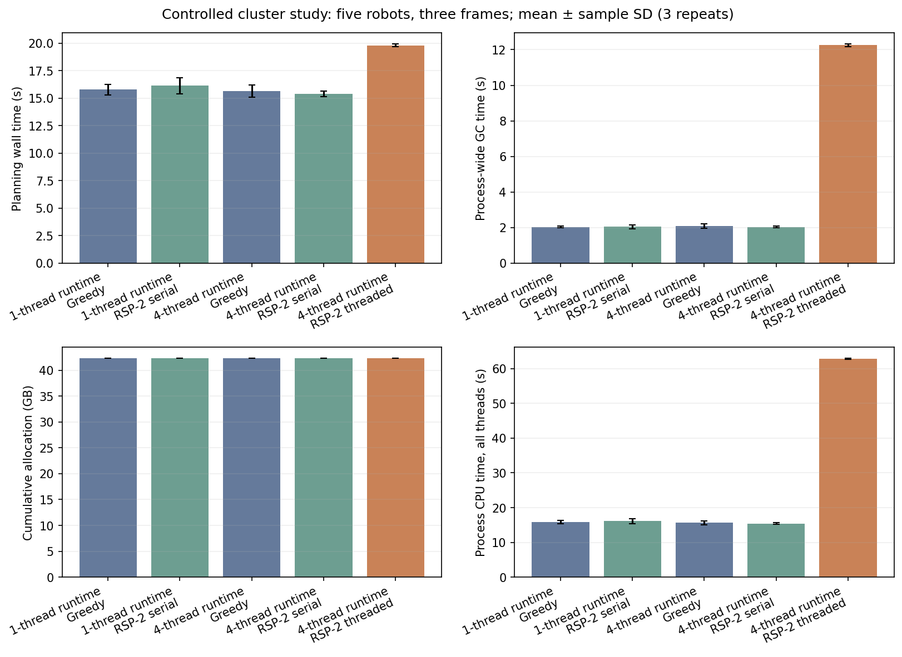
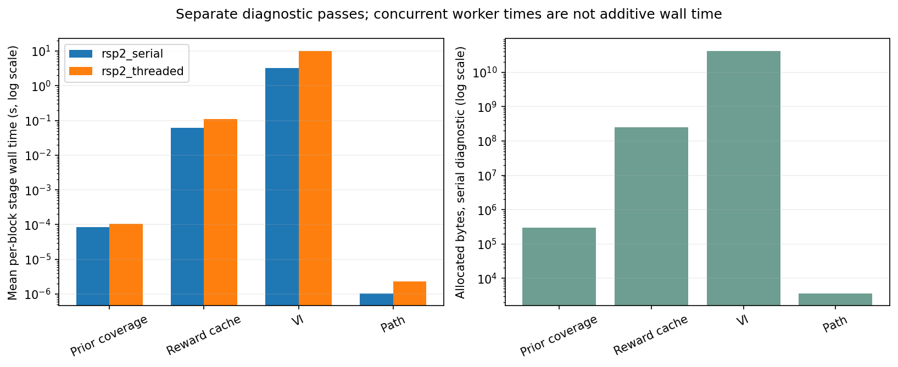
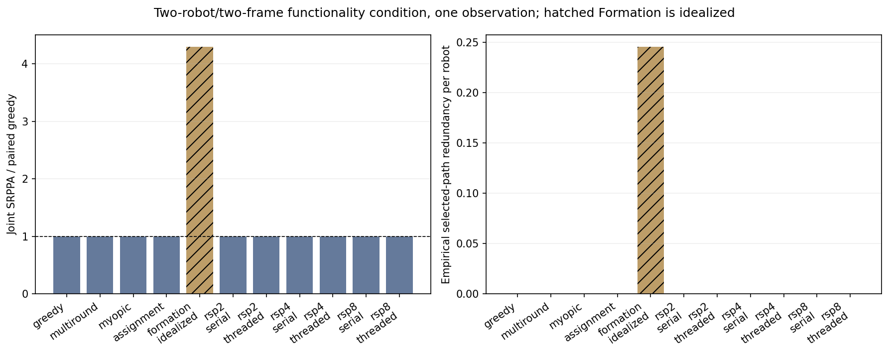

# Phase 4 initial controlled study

RSP-2 retained 99.83% of fixed-order greedy joint SRPPA in the matched five-robot
condition and reduced occupied planning rounds from five to two. Actual threading
was **28.6% slower than serial RSP** on this host. The measurements locate the
largest cost in allocation-heavy VI and increased recorded GC time, rather than
partition dispatch. These are small controlled measurements, not full-scale
results, a reproduction of complete paper scenarios, or a general speedup claim.

## Source, inputs and controls

Measured across 2026-11-02/03 UTC from clean commit
`3f646d655fa90e82bcd459e8c65f2dec36c8091d`, based on Phase 3 merge `a991909`.
Every run records source digest
`453e0d8a665a0155c6eb6e71b6ef80097c17a38b34860de02183dd6330109692`.
Julia 1.8.5; BLAS threads 1; Julia threads 4 or 1 in separate sequential processes;
identical CPU affinity 0–3; four-CPU cgroup quota; 32 GiB memory limit. This is a
managed host, not an exclusive-machine measurement. GC stays enabled, with a full
collection before each primary run outside its timer. Compilation is warmed;
installation, input loading, assignment generation, legacy scoring, authoritative
scoring/validation, rendering and serialization are excluded from planning time.
Detailed profiling uses separate passes. See [PHASE4.md](PHASE4.md) for boundaries.

No precomputed trajectories were loaded. All measured plans were generated here.
The four-thread process produced 29 primary plans / 94 observed VI calls; the
one-thread control produced 6 plans / 30 calls. Warmups, ten diagnostic VI calls
and the separate horizon-eight validation add work outside those primary counts.
Whole-process peak RSS, including warmup, was 1.016 GB (four threads) and 0.697 GB
(one thread). Cumulative allocations below are not live memory requirements.

Original scenario JSON is unchanged, with exact filming source revision and
SHA-256 provenance in [SOURCES.toml](../third_party/SOURCES.toml):

| Input | Original grid / actors / robots / frames | Explicit initial-study window |
| --- | --- | --- |
| cluster | 20×20 / 6 / 5 / 60 | N=5,H=3, frames 1:3; N=2,H=2, frames 1:2 |
| split_and_join | 29×29 / 4 / 5 / 80 | N=2,H=2, original frames 30:31 |
| priority_speaker | 25×25 / 10 / 6 / 60 | N=2,H=2, original frames 15:16 |

The latter two runs verify ingestion, planning and common evaluation of exact
source inputs. Two-frame windows do not reproduce the complete split/join or
speaker events. Camera geometry/override, actor poses and weights, grid, motion,
VI limits/tolerance/discount and baseline update rules are unchanged. A/B are
untouched; only C contains opt-in measurement wrappers.

## Matched five-robot, three-frame comparison

Initial-state seed 2026, partition seed 11, original six actors and 20×20 grid.
Each row has three timing repeats. SD is descriptive sample SD, not a confidence
interval. RSP serial/threaded trajectories and all score fields match exactly;
they also match the freshly generated one-thread-runtime trajectories. Each
planner makes five VI calls per run.

| Planner / Julia runtime | Joint SRPPA | / paired greedy | Configured / occupied rounds | Planning s mean ± SD | GC s mean | Allocated GB mean | Process CPU s mean |
| --- | --- | --- | --- | --- | --- | --- | --- |
| Greedy / 1 thread | 10.730734237108 | 1.000000000 | 5 / 5 | 15.777 ± 0.482 | 2.036 | 42.347 | 15.775 |
| RSP-2 serial / 1 thread | 10.712121493082 | 0.998265473 | 2 / 2 | 16.135 ± 0.730 | 2.048 | 42.347 | 16.133 |
| Greedy / 4 threads | 10.730734237108 | 1.000000000 | 5 / 5 | 15.650 ± 0.563 | 2.086 | 42.347 | 15.648 |
| RSP-2 serial / 4 threads | 10.712121493082 | 0.998265473 | 2 / 2 | 15.396 ± 0.232 | 2.028 | 42.347 | 15.395 |
| RSP-2 threaded / 4 threads | 10.712121493082 | 0.998265473 | 2 / 2 | 19.802 ± 0.129 | 12.252 | 42.347 | 62.823 |

Assignments by robot ID are `[2,2,1,1,2]`. Ratio of mean serial/threaded RSP time is
0.777515×; the mean of per-repeat paired speedups is 0.777502 ± 0.008915×. These
are measured slowdowns despite a 60% reduction in logical dependency depth from
greedy's five rounds. Relative to greedy in the four-thread runtime, threaded RSP
also takes longer (19.802 versus 15.650 s). Sequential execution in a four-thread
runtime alone does not show a comparable penalty in this control.

One additional partition seed checks quality variability under identical states:

| Partition seed | Assignments | Occupied | Joint SRPPA | / greedy | Serial s | Threaded s | Serial/threaded |
| --- | --- | --- | --- | --- | --- | --- | --- |
| 11 | [2,2,1,1,2] | 2 | 10.712121493082 | 0.998265473 | 15.396 mean | 19.802 mean | 0.777515 ratio of means |
| 22 | [2,2,1,2,1] | 2 | 10.738715239864 | 1.000743752 | 17.260 | 18.856 | 0.915325 |

Seed 22 has one timing observation per mode. It cannot establish a seed-specific
timing effect. Both rewards and greedy agree with Phase 3 to their saved numeric
precision; this is a fidelity check, not reuse of those old solutions. Random
ordering/ignored same-round decisions can score above or below fixed-order greedy.
Two partition seeds under one initial condition do not justify a quality CI.

Empirical selected-path redundancy `[sum_i F({x_i}) - F(X)]/N` is 1.354694 for
greedy, 1.328288 for RSP seed 11, and 1.328961 for seed 22. These numbers describe
these selected paths; they are not a worst-case redundancy bound. N=2 and N=5
conditions here use different horizons/seeds, so they do not establish a team-size
redundancy scaling curve.

## Where the time and allocation go

Separate sampled diagnostic passes, each with five original VI calls:

| Stage | Serial sum wall s | Serial allocated bytes | Serial GC s | Threaded mean per-block wall s |
| --- | --- | --- | --- | --- |
| Prior coverage | 0.000429245 | 296,224 | 0 | 0.000107341 |
| Reward cache | 0.304927 | 248,474,960 | 0.011015 | 0.109973 |
| Value iteration | 16.098887 | 42,098,227,520 | 2.153945 | 10.171380 |
| Path extraction | 0.000005177 | 3,600 | 0 | 0.000002323 |

VI accounts for **99.4125% of serial stage allocation**. Prior construction and
path extraction are tiny in this condition; reward-cache construction is also a
small fraction of VI cost. Threaded stage allocation/GC attribution is null because
process-counter windows overlap. Concurrent worker wall times cannot be added to
obtain parallel elapsed time. The diagnostic planning times, 16.405 s serial and
20.127 s threaded, are not pooled with unprofiled primary timing samples.

The primary matched RSP runs allocate the same 42.347 GB within about 6 KB of
execution bookkeeping, yet mean recorded GC time rises from 2.028 to 12.252 s.
The remaining elapsed time after subtraction is 13.369 versus 7.550 s; this is
consistent with useful overlapping work being outweighed by GC delays. Subtraction
is not a controlled GC-free experiment and cannot predict a GC-free speedup.
Process CPU time also rises from 15.395 to 62.823 s across all workers.

Sampling stacks contain `neighbors`, `transition`, Julia allocator/sweep frames,
`jl_safepoint_wait_gc` and `jl_gc_state_set`. The preserved transition function
rebuilds a neighbor vector for each state/action evaluation; the source also
allocates temporary successor distributions. Together with the stage allocation
counters, these identify VI allocation/GC as the first optimization target for a
future separately reviewed change. No transition, action order, cache, kernel or
VI behavior was optimized in this phase. Stack samples include parked workers
and are not CPU-utilization percentages.

### Scheduling and waiting

The unchanged scheduler with no-op blocks, N=5, seed 11, 100 warmed repetitions:

| Configured / occupied rounds | Serial mean µs (4-thread runtime) | Threaded mean µs | Threaded maximum µs |
| --- | --- | --- | --- |
| 2 / 2 | 3.46 | 27.86 | 129.00 |
| 4 / 4 | 3.25 | 70.91 | 547.37 |
| 8 / 5 | 3.34 | 124.28 | 345.88 |

This control includes tracing overhead and isolates dispatch/barriers without VI;
it does not represent filming planning or directly measure OS task parking.
In actual matched RSP-2 runs the mean wall residual outside the union of planning
blocks is 0.000066 s serial and 0.000422 s threaded. Pure dispatch overhead of this
size cannot account for the observed 4.406 s elapsed-time penalty.

The completion-skew proxy averages 0.788 **worker-seconds** per threaded run and
omits workers unused by a partition. It is not additive to elapsed wall time and
not an exact synchronization-wait counter. GC/safepoint stacks provide additional
waiting evidence. Hardware counters are unavailable, so the data cannot uniquely
separate collector work, safepoint coordination, allocator contention or memory
bandwidth/cache contention. Workload size, round occupancy and the Julia 1.8.5
runtime may interact; no universal causal claim follows from this host/study.

## Other baselines and scenario checks

The two-robot/two-frame cluster condition uses initial seed 2027 and partition
seed 22, one observation per planner/mode. All feasible planners happen to score
1.480678763738 with zero selected-path redundancy; this short condition checks
functionality and is not informative as an algorithm ranking.

| Planner | VI calls | Configured / occupied | Serial s | Threaded s |
| --- | --- | --- | --- | --- |
| Greedy | 2 | 2 / 2 | 3.408 | — |
| Multi-round greedy | 4 | 4 / 4 dependency stages (2 sweeps) | 6.320 | — |
| Myopic | 2 | 1 / 1 information round | 3.261 | — |
| Assignment | 2 | n/a; information depth 1 | 3.164 | — |
| RSP-2 | 2 | 2 / 1; [2,2] | 3.024 | 4.408 |
| RSP-4 | 2 | 4 / 2; [3,4] | 3.067 | 4.723 |
| RSP-8 | 2 | 8 / 2; [6,7] | 3.053 | 4.370 |

RSP-4/8 have singleton occupied partitions here, but their threaded wrappers are
still slower. Their increased GC time (1.577/1.343 s versus serial 0.402/0.394 s)
shows runtime cost can arise even without useful within-round concurrency. These
are one-observation two-robot checks, not five-robot RSP-4/8 profiling conclusions.

**Original Formation is an idealized, differently constrained reference.** It
ignores supplied initial states and VI motion/grid feasibility: joint SRPPA
6.359919417850, /greedy 4.295273, zero VI calls, ~84 µs, redundancy 0.245556. This
must not be ranked as a feasible planner's quality or speedup. Legacy value 1.0
remains separately labeled. All planners use the same authoritative evaluator;
heading/stationary bonuses are separate from joint SRPPA.

Additional windows, initial seed 2026 / partition seed 11, N=2,H=2:

| Scenario | Joint SRPPA, greedy and both RSP-2 modes | / greedy | RSP occupied / configured | Greedy s | RSP serial s | RSP threaded s |
| --- | --- | --- | --- | --- | --- | --- |
| split_and_join 30:31 | 2.337827851395 | 1.000000 | 1 / 2 | 6.725 | 6.969 | 8.788 |
| priority_speaker 15:16 | 8.253280459713 | 1.000000 | 1 / 2 | 5.278 | 4.999 | 6.848 |

## Validation and artifacts

- Julia package suite: **625 assertions passed**, including all earlier phase
  regressions and 43 new configuration/profiling assertions.
- Primary four-thread and one-thread artifact validators: **267 and 56 passed**.
- Separate-process paired replay validator: **51 passed**, including identical
  initial states, camera/VI settings, source/input hashes, assignments, trajectories
  and scores across Julia worker counts.
- All 35 primary plans pass structural/horizon checks and marginal consistency;
  feasible planners pass initial-state and original movement checks. Maximum
  marginal discrepancy is **8.22e-15**.
- All ten profiled policies have zero independent Bellman residual over 9,600
  states each. A separate N=1,H=8 check has zero residual over **25,600 states** and
  passes movement/marginal checks. Its cold timing is not performance evidence;
  this does not validate arbitrary longer/full horizons. Iteration counts are
  unavailable from the preserved library and are null.
- Implementation Actions [41549004992](https://github.com/praveenarvind/Combined-Project/actions/runs/41549004992)
  passed. The final workflow also adds a fresh one-thread cold CI replay against
  its four-thread functional output; cold CI times are never benchmark results.

Raw and derived artifacts are in [benchmarks/phase4](benchmarks/phase4):
[four-thread CSV](benchmarks/phase4/four-thread/results.csv),
[full JSON](benchmarks/phase4/four-thread/run.json),
[summary CSV](benchmarks/phase4/four-thread/summary.csv),
[one-thread control](benchmarks/phase4/one-thread/run.json), sampling trees/flat
stacks, no-op controls, horizon-eight certificate, validation log and PNG/PDF plots.
`SHA256SUMS` covers the saved artifacts. Profile text has trailing whitespace
normalized for Git; stack counts and numerical JSON/CSV data are unchanged. Raw JSON records separate legacy scores,
bonuses, input frame windows/hashes, seeds, trajectories, execution traces and
measurement settings. Summaries collapse timing repeats for quality statistics;
no CIs are estimated with fewer than ten independent initial seeds. The pooled
summary timing for N=5 includes the extra seed-22 observation; the matched timing
table above uses only the three seed-11 repeats.

## Proposed full study — review required, not executed

Use explicit paired cases, predeclared seeds and randomized/rotated blocked
planner order. Keep Formation separately labeled. Never pool duplicate serial/
threaded quality as independent samples. Bootstrap at the initial-state seed
level, with partition seeds and timing repeats nested; report occupancy, not just
configured partitions. Initial-state variation is conditional on fixed actor
inputs; it is not a sample of arbitrary filming scenes.

| Stage | Proposed design | Measured VI calls / cost estimate |
| --- | --- | --- |
| Resource gate | Warmed N=1,H=6 and N=10,H=6 cluster probes; 1/2/4-thread diagnostic pairs and Bellman checks before expansion | Tens of calls, minutes; revise estimates from observed peak RSS/time |
| Core quality grid | cluster N={2,5}, H={3,6}; 10 initial seeds × 3 partition seeds; greedy and RSP-2/4/8 serial+threaded; one observation per seed/mode | 2,940 calls, 840 plans; roughly 3–8 h plus warmup/validation |
| Other baselines | cluster N=5,H=3; same 10 initial seeds; greedy, multi-round, myopic, assignment, idealized Formation | 400 calls, 50 plans; multi-round accounts for 250 calls |
| Timing/worker stratum | N=5,H=3; 3 of those initial seeds × 2 partition seeds; 3 repeats at Julia 1/2/4 workers, BLAS1; all RSP modes that are possible | 1,410 additional calls beyond core grid; roughly 1.5–3 h |
| Larger-team extension | Add N=10 to the core grid only after the resource gate; retain H, seeds and planner pairing | 4,200 extra calls; roughly 5–12 h, subject to measured H=6 cost |
| Scene generalization | Preselect split/join and speaker event windows; run the same paired protocol after reviewing cluster costs | Budget separately; grids/actor counts differ |

The proposed core plus baseline/worker strata totals **4,750** measured calls;
including N=10 totals **8,950**. Estimates use observed H=3 costs (~3.1 s/VI serial,
~4.0 s/VI threaded), a conservative H=6 multiplier rather than a fitted scaling
law, and extra allowance for validation/shared-host variation. They are planning
estimates, not measured scalability. Budget in bounded batches and stop/review on
nonconvergence, replay failure, unexpected RAM growth or cost exceeding the
approved envelope. The current default 100-call guard prevents these grids from
starting automatically. Ten initial seeds support only exploratory CIs; increase
to 20+ for final reporting if precision/budget warrants it.

The worker stratum uses three repetitions of 7 planners at worker counts 2/4 and
four serial planners at worker count 1. Its 1,620 calls include 210 already present
in the core grid, hence 1,410 additional. Larger worker counts need a host with a
matching CPU quota. Team counts above the original five are explicit controlled
extensions using the preserved camera/motion model, not unmodified paper inputs.
No full matrix, rendering, R-IRSP, theoretical guarantee or Phase 5 was run.
